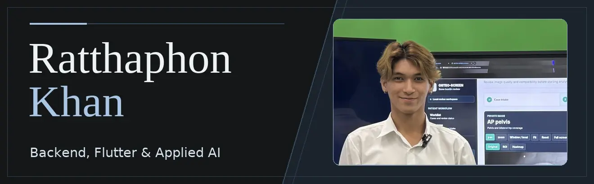

**I build backend services and Flutter apps, often for projects that start with a camera or sensor.**

I'm studying Digital Science and Technology at Kasetsart University, Sriracha Campus, with a GPA of **3.90/4.00**.

[**Portfolio**](https://ratthaphon0.github.io/) · [**LinkedIn**](https://www.linkedin.com/in/ratthaphon-khan-176577371/) · [**Public repositories**](https://github.com/ratthaphon0?tab=repositories)

## Selected work

### [Matchanu](https://ratthaphon0.github.io/#matchanu) · First place at the KU Innovation Contest

I worked on the infrastructure for a Raspberry Pi prototype that measures dissolved oxygen, pH, water temperature, and turbidity in fish ponds. Our team took first place in the undergraduate Science and Technology category at Kasetsart University, Kamphaeng Saen, in November 2026.

[University award report and cover photo source](https://sci.src.ku.ac.th/?p=17314)

### [AFD-Care](https://ratthaphon0.github.io/#afd-care) · Fall detection and caregiver app

I built the fall detection pipeline and the Flutter app for the prototype. Caregivers can check cameras, see past events, and review alerts in the app.

Inside the AFD-Care prototype

The pipeline uses YOLO pose estimation and a GRU classifier, with ONNX inference targeting Orange Pi. FastAPI and Laravel services use Redis to process events. The prototype queues events offline and can send alerts through FCM, LINE, and Telegram.

### [Duriya](https://ratthaphon0.github.io/#duriya) · Thai music practice

I contributed to a Flutter prototype that records practice sessions and sends WAV audio to a FastAPI and PostgreSQL backend for background analysis. Teachers can review experimental feedback on notes and rhythm.

### [KU Conference 2026](https://ratthaphon0.github.io/#projects) · Conference platform

I built API integrations and health checks, configured backend services, and documented the staging setup for the GitLab team.

## Browse the code

- **[Smart Canteen](https://github.com/ratthaphon0/SmartCanteen-proj)**. Seat occupancy dashboard built with React and FastAPI. I trained YOLO on our custom canteen dataset using an A100 on the Nontri AI Cluster.
- **[Thai Tourism Dashboard](https://github.com/ratthaphon0/thai-tourism-dashboard)**. Compare hotel occupancy across Thailand's 77 provinces from 2019 to 2023. [Live dashboard](https://thai-tourism-dashboard.vercel.app/).
- **[AsixfShop](https://github.com/ratthaphon0/shopping-website)**. PHP e-commerce project with cart, checkout, and product management.
- **[Portfolio site](https://github.com/ratthaphon0/ratthaphon0.github.io)**. Source for my portfolio and project write-ups.

## Tools I use

- **Backend** · Python, FastAPI, Laravel, PostgreSQL, Redis
- **Mobile and web** · Dart, Flutter, TypeScript, React
- **Applied AI and edge** · YOLO, ONNX, OpenCV, Raspberry Pi, Orange Pi
- **Infrastructure** · Docker, Linux, Git

I'm interested in software development internships and cooperative education, especially in backend and mobile development. [Connect on LinkedIn](https://www.linkedin.com/in/ratthaphon-khan-176577371/).
