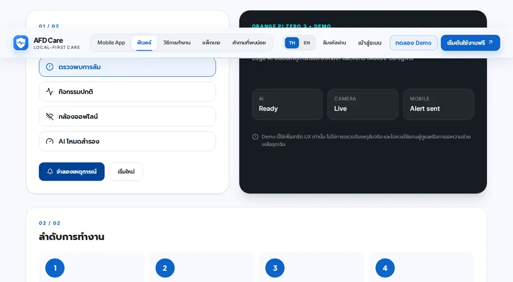

**I build backend services and Flutter apps, often for projects that start with a camera or sensor.**

I study Digital Science and Technology at Kasetsart University, Sriracha Campus (**3.90/4.00**). I’m looking for a backend or mobile co-op.

[**Portfolio**](https://ratthaphon0.github.io/) · [**LinkedIn**](https://www.linkedin.com/in/ratthaphon-khan-176577371/) · [**Public repositories**](https://github.com/ratthaphon0?tab=repositories)

## GitHub in numbers

 

Snapshot from 26 November 2026 · [Contribution calendar](https://github.com/ratthaphon0?tab=overview&from=2026-01-01&to=2026-11-26) · [Public repositories](https://github.com/ratthaphon0?tab=repositories)

## Selected work

### 🏆 Matchanu

Our team won **first place in undergraduate Science and Technology** at the KU Innovation Contest in November 2026. I worked on infrastructure for our Raspberry Pi prototype, which measures oxygen, pH, temperature and turbidity in fish ponds.

[Explore Matchanu](https://ratthaphon0.github.io/#matchanu) · [KU award report and team photograph](https://sci.src.ku.ac.th/?p=17314)

 

**[AFD-Care](https://ratthaphon0.github.io/#afd-care)** · I built the fall detection pipeline and the Flutter app that caregivers use to check cameras and review alerts.

Inside the AFD-Care prototype

The pipeline uses YOLO pose estimation and a GRU classifier, with ONNX inference targeting Orange Pi. FastAPI and Laravel services use Redis to process events. The prototype queues events offline and can send alerts through FCM, LINE, and Telegram.

**[Duriya](https://ratthaphon0.github.io/#duriya)** · I helped build a Flutter prototype for Thai music practice. It sends recorded audio to FastAPI so teachers can review feedback on notes and rhythm.

**[KU Conference 2026](https://ratthaphon0.github.io/#projects)** · I built API integrations and health checks, configured backend services, and documented the staging setup.

## Browse the code

- **[Smart Canteen](https://github.com/ratthaphon0/SmartCanteen-proj)**. Seat occupancy dashboard built with React and FastAPI. I trained YOLO on our custom canteen dataset using an A100 on the Nontri AI Cluster.
- **[Thai Tourism Dashboard](https://github.com/ratthaphon0/thai-tourism-dashboard)**. Compare hotel occupancy across Thailand's 77 provinces from 2019 to 2023. [Live dashboard](https://thai-tourism-dashboard.vercel.app/).
- **[AsixfShop](https://github.com/ratthaphon0/shopping-website)**. PHP e-commerce project with cart, checkout, and product management.
- **[Portfolio site](https://github.com/ratthaphon0/ratthaphon0.github.io)**. Source for my portfolio and project write-ups.

## Tools I use

     

Python · FastAPI · Flutter · PostgreSQL · Docker · React
