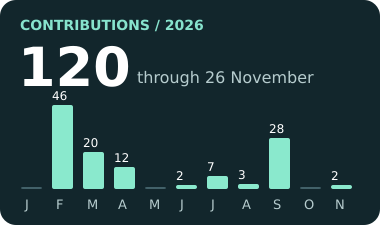
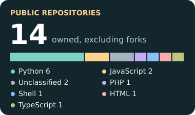
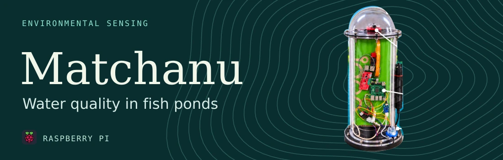
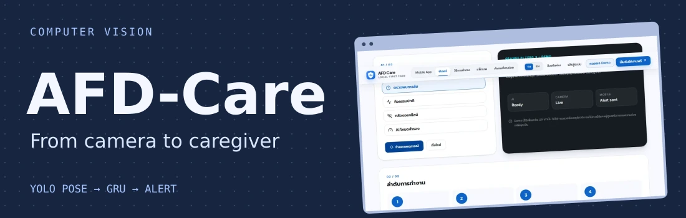

**I build backend services and Flutter apps, often for projects that start with a camera or sensor.**

I study Digital Science and Technology at Kasetsart University, Sriracha Campus (**3.90/4.00**). I’m looking for a backend or mobile co-op.

[**Portfolio**](https://ratthaphon0.github.io/) · [**LinkedIn**](https://www.linkedin.com/in/ratthaphon-khan-176577371/) · [**Public repositories**](https://github.com/ratthaphon0?tab=repositories)

## GitHub in numbers

 

Snapshot from 26 November 2026 · [Contribution calendar](https://github.com/ratthaphon0?tab=overview&from=2026-01-01&to=2026-11-26) · [Public repositories](https://github.com/ratthaphon0?tab=repositories)

## Selected work

### 

**First place · KU Innovation Contest, November 2026**

Our team built Matchanu to measure dissolved oxygen, pH, temperature and turbidity in fish ponds. I worked on the infrastructure for the Raspberry Pi prototype. We won the undergraduate Science and Technology category.

[Explore Matchanu](https://ratthaphon0.github.io/#matchanu) · [Read the university award report](https://sci.src.ku.ac.th/?p=17314)

### 

**Fall detection and caregiver alerts**

I built the fall detection pipeline and the Flutter app. A caregiver can open an alert, check the camera and look back at earlier events.

<strong>How does a camera event reach a caregiver?</strong>

1. **Read the movement.** YOLO estimates body pose from camera frames. A GRU classifier looks at the sequence for signs of a fall. ONNX inference targets the Orange Pi.
2. **Queue the event.** FastAPI and Laravel services use Redis to process events. The prototype can queue events while offline.
3. **Notify the caregiver.** The prototype supports FCM, LINE and Telegram alerts. Caregivers can review the event in the Flutter app.

[See the AFD-Care prototype](https://ratthaphon0.github.io/#afd-care)

### 

**Record a practice session. Review the notes and rhythm.**

I helped build a Flutter prototype for Thai music students. It sends recorded WAV audio to a FastAPI backend for analysis, so teachers can review the experimental feedback alongside the practice session.

[Explore Duriya](https://ratthaphon0.github.io/#duriya)

**[KU Conference 2026](https://ratthaphon0.github.io/#projects)** · I built API integrations and health checks, configured backend services, and documented the staging setup.

## Browse the code

- **[Explore the Smart Canteen occupancy dashboard](https://github.com/ratthaphon0/SmartCanteen-proj)** · React and FastAPI. I trained YOLO on our canteen dataset using an A100 on the Nontri AI Cluster.
- **[Compare hotel occupancy across 77 Thai provinces](https://thai-tourism-dashboard.vercel.app/)** · Explore data from 2019–2023 or [read the dashboard source](https://github.com/ratthaphon0/thai-tourism-dashboard).
- **[Follow a checkout in AsixfShop](https://github.com/ratthaphon0/shopping-website)** · A PHP storefront with a cart, checkout and product management.
- **[See how I built my portfolio](https://github.com/ratthaphon0/ratthaphon0.github.io)** · Source for the site and project write-ups.

## Tools I use

     

Python · FastAPI · Flutter · PostgreSQL · Docker · React
